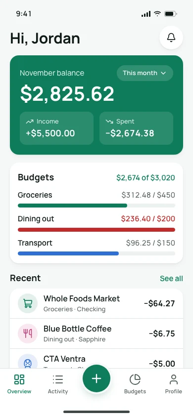
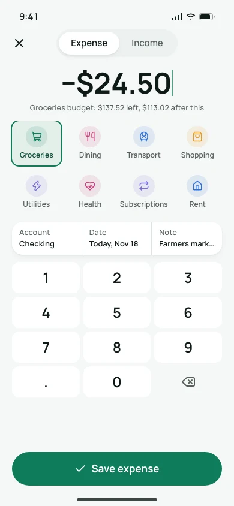
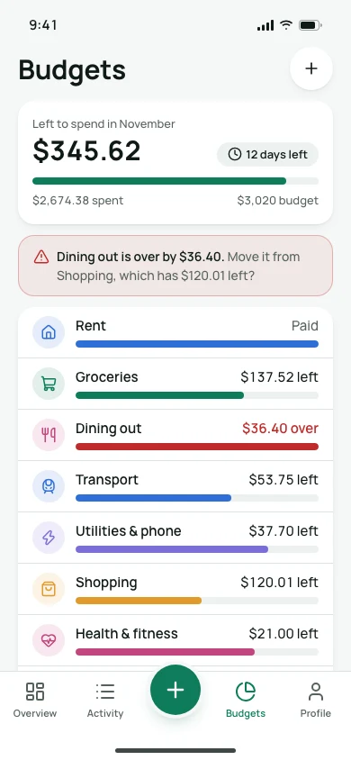
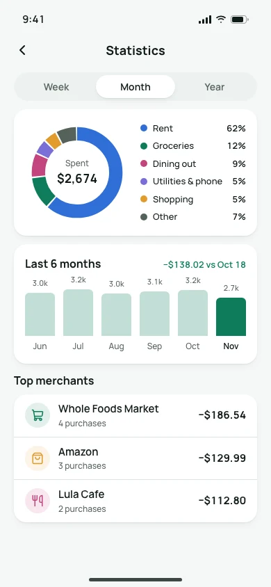

# Budgeting app UI template

A free, complete UI design for a budgeting and expense tracking app: eight phone screens with one month of realistic money data that adds up across every screen, built on the [Wallet design system](https://codexdesign.io/design-systems/wallet). Clone it and ask Codex or Claude Code to turn it into your app.

   

## Screens

| # | Screen | What's on it |
| --- | --- | --- |
| 1 | [Overview](screens/01-overview.html) | Month balance, income and spending, budget progress, recent transactions |
| 2 | [Add transaction](screens/02-add.html) | Expense or income, amount keypad, categories, account, date, note |
| 3 | [Transactions](screens/03-transactions.html) | Search, filters, transactions grouped by day with daily totals |
| 4 | [Transaction detail](screens/04-transaction.html) | Amount, category, account, date, note, receipt, splitting the bill |
| 5 | [Budgets](screens/05-budgets.html) | Left to spend this month, each category's budget, an overspending alert |
| 6 | [Statistics](screens/06-statistics.html) | Spending by category, the last six months, top merchants |
| 7 | [Accounts](screens/07-accounts.html) | Net worth, bank, savings, cash, credit and investment accounts |
| 8 | [Profile](screens/08-profile.html) | Profile, streaks, currency, reminders, data export, settings |

The sample data is one person's November in US dollars: $5,500.00 in, $2,674.38 out, eight budgets totaling $3,020.00, and a net worth equal to the sum of the accounts. Income is green with a plus sign; spending uses the text color with a minus sign; red appears only on the over-budget category. Charts are SVG.

Each screen is one HTML file at 390×844, styled with Tailwind CSS v4 (loaded from a CDN) and the shared `tokens.css`. Light is the default; add `class="dark"` to `<html>` for the dark theme. Open any file in a browser; there is nothing to install or build.

## Use it

Copy just this template:

```bash
npx degit ummydev/ui-templates/apps/budgeting my-budget-app
```

Then ask your agent to make it yours:

```text
This folder is a budgeting app UI template. Turn it into [your app name], for [who it's for]. Keep DESIGN.md and tokens.css as the design system, change the currency to [your currency] and the categories to [your categories], and keep every total consistent across screens. Then build these screens in [Expo / SwiftUI / your stack].
```

## Files

```text
DESIGN.md      the Wallet design system: colors, type, spacing, app rules
tokens.css     the same tokens as CSS variables, light and dark
screens/       eight HTML screens
screenshots/   WebP screenshots at 1x and 2x
```

## Design system

Wallet is calm and trustworthy: clear balances in Manrope with tabular figures, one steady green, 18px corners and 48px touch targets. See it live, with a shadcn theme and the full DESIGN.md, at [codexdesign.io/design-systems/wallet](https://codexdesign.io/design-systems/wallet).

## License

MIT. Use it in personal and commercial projects.
