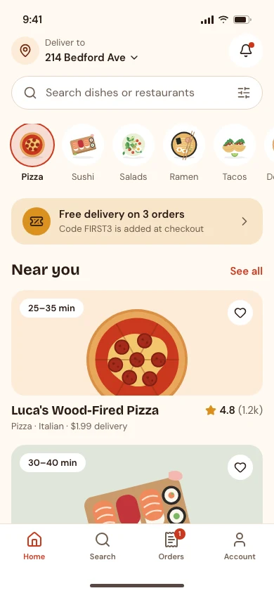
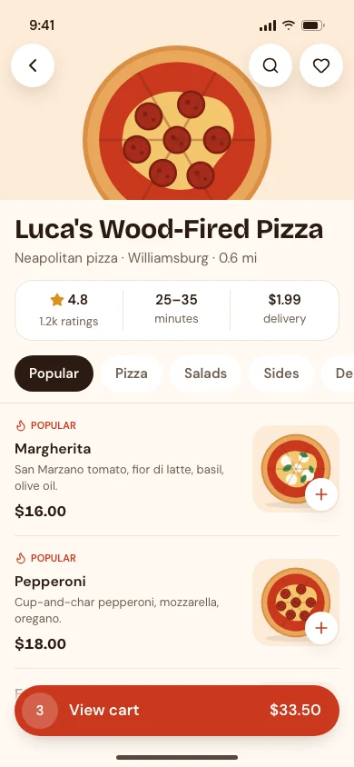
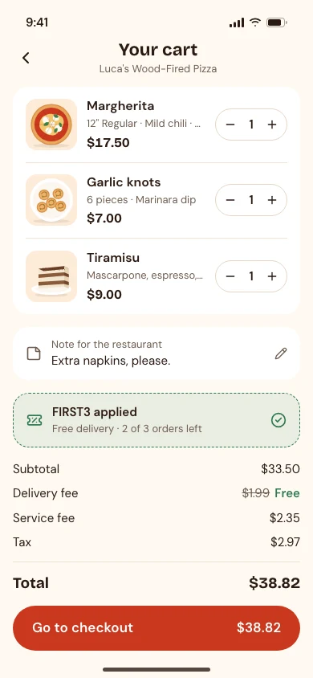
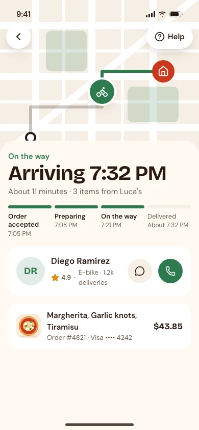

# Food delivery app UI template

A free, complete UI design for a food ordering and delivery app: eight phone screens with realistic restaurants, dishes and prices, built on the [Pantry design system](https://codexdesign.io/design-systems/pantry). Clone it and ask Codex or Claude Code to turn it into your app.

   

## Screens

| # | Screen | What's on it |
| --- | --- | --- |
| 1 | [Home](screens/01-home.html) | Delivery address, search, cuisine categories, an offer, restaurants near you |
| 2 | [Restaurant](screens/02-restaurant.html) | Rating, delivery time and fee, menu tabs, dishes with add buttons, a sticky cart bar |
| 3 | [Item](screens/03-item.html) | Description, size, spice level and extras with prices, quantity, add to cart |
| 4 | [Cart](screens/04-cart.html) | Items with quantity steppers, a note for the restaurant, a promo code, the fee breakdown |
| 5 | [Checkout](screens/05-checkout.html) | Address, standard or scheduled delivery, payment method, rider tip, place order |
| 6 | [Tracking](screens/06-tracking.html) | Map with the rider, arrival time, order steps, rider contact, order summary |
| 7 | [Orders](screens/07-orders.html) | The order in progress and past orders with reorder |
| 8 | [Account](screens/08-account.html) | Profile, totals, a referral offer, addresses, payment methods, settings |

Each screen is one HTML file at 390×844, styled with Tailwind CSS v4 (loaded from a CDN) and the shared `tokens.css`. The dish and restaurant pictures are 12 flat SVG illustrations in `assets/food`, so the template has no external images. Open any file in a browser; there is nothing to install or build.

## Use it

Copy just this template:

```bash
npx degit ummydev/ui-templates/apps/food-ordering my-food-app
```

Then ask your agent to make it yours:

```text
This folder is a food delivery app UI template. Turn it into [your app name], for [your restaurants or your market]. Keep DESIGN.md and tokens.css as the design system, replace the sample restaurants, dishes and prices with [your menu], and replace the illustrations with your own photos. Then build these screens in [Expo / SwiftUI / your stack].
```

## Files

```text
DESIGN.md      the Pantry design system: colors, type, spacing, app rules
tokens.css     the same tokens as CSS variables, light and dark
screens/       eight HTML screens
assets/food/   twelve dish illustrations as SVG
screenshots/   WebP screenshots at 1x and 2x
```

## Design system

Pantry is warm and appetizing: a cream background, tomato red for ordering, herb green for delivery and success, big rounded food cards, pill buttons and 48px touch targets. See it live, with a shadcn theme and the full DESIGN.md, at [codexdesign.io/design-systems/pantry](https://codexdesign.io/design-systems/pantry).

## License

MIT. Use it in personal and commercial projects.
