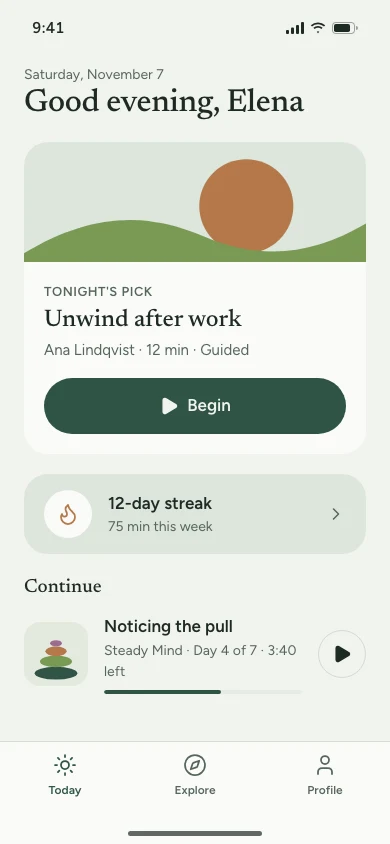
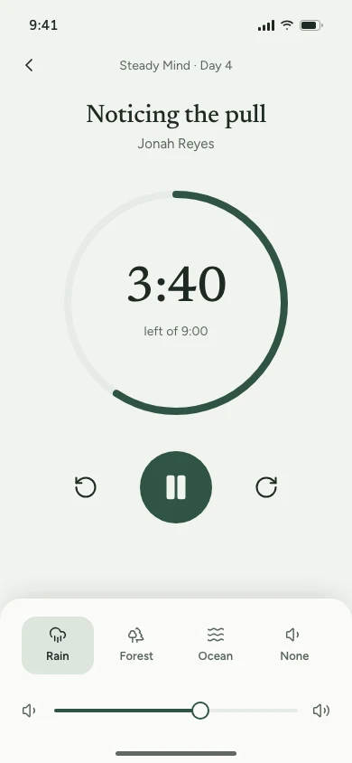
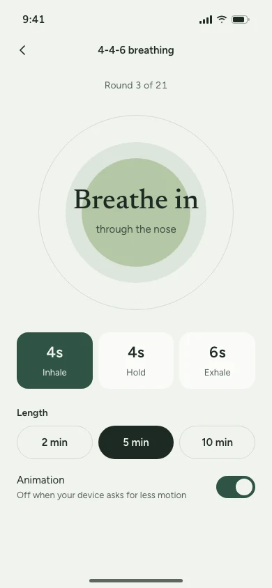
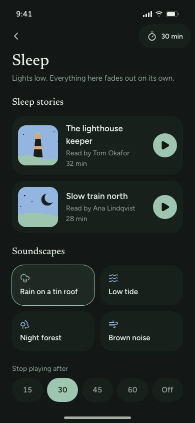

# Meditation app UI template

A free, complete UI design for a meditation and sleep app: eight phone screens for a sample app called Stillpoint, with practice data that matches across every screen, built on the [Calm design system](https://codexdesign.io/design-systems/calm). Clone it and ask Codex or Claude Code to turn it into your app.

   

## Screens

| # | Screen | What's on it |
| --- | --- | --- |
| 1 | [Today](screens/01-today.html) | Tonight's pick, the streak, minutes this week, and the session to continue |
| 2 | [Explore](screens/02-explore.html) | Sleep, focus, anxiety and breathing, each a row of sessions with their length |
| 3 | [Course](screens/03-course.html) | A seven-day course with its teacher, every session, and what's done |
| 4 | [Player](screens/04-player.html) | A progress ring, time left, skip back and forward, and a background sound |
| 5 | [Breathing](screens/05-breathe.html) | A 4-4-6 breathing guide with rounds, length, and an animation that respects reduced motion |
| 6 | [Sleep](screens/06-sleep.html) | Always dark: sleep stories, soundscapes, and a timer that stops playback |
| 7 | [Progress](screens/07-progress.html) | Streak, total minutes and sessions, this week's chart, and a mood log |
| 8 | [Profile](screens/08-profile.html) | Subscription, reminders, downloads, sound, and settings |

The sample data is one person's practice on Saturday, November 7: a 12-day streak, 75 minutes this week (12, 10, 20, 8, 15 and 10 a day), 1,286 minutes over 142 sessions in all. The Steady Mind course has seven sessions totaling 69 minutes; three are done, and day 4 has 3:40 of 9:00 left on the Today, Course and Player screens alike. The breathing rhythm is 4 seconds in, 4 held and 6 out, so 5 minutes is 21 rounds. Illustrations are flat SVG shapes in the Calm colors; icons are Lucide.

Each screen is one HTML file at 390×844, styled with Tailwind CSS v4 (loaded from a CDN) and the shared `tokens.css`. Light is the default; add `class="dark"` to `<html>` for the dark theme. The Sleep screen is always dark. Open any file in a browser; there is nothing to install or build.

## Use it

Copy just this template:

```bash
npx degit ummydev/ui-templates/apps/meditation my-meditation-app
```

Then ask your agent to make it yours:

```text
This folder is a meditation app UI template. Turn it into [your app name], for [who it's for]. Keep DESIGN.md and tokens.css as the design system, replace the courses, teachers and sounds with [your content], and keep the streak, minutes and session progress consistent across screens. Then build these screens in [Expo / SwiftUI / your stack].
```

## Files

```text
DESIGN.md      the Calm design system: colors, type, spacing, app rules
tokens.css     the same tokens as CSS variables, light and dark
screens/       eight HTML screens
screenshots/   WebP screenshots at 1x and 2x
```

## Design system

Calm slows the screen down: a soft sage background, deep green for actions, Newsreader for titles and Figtree for text, 24px corners, 48px touch targets and a three-item tab bar. See it live, with a shadcn theme and the full DESIGN.md, at [codexdesign.io/design-systems/calm](https://codexdesign.io/design-systems/calm). Calm is the name of the design system only; it is not affiliated with any app of that name.

## License

MIT. Use it in personal and commercial projects.
