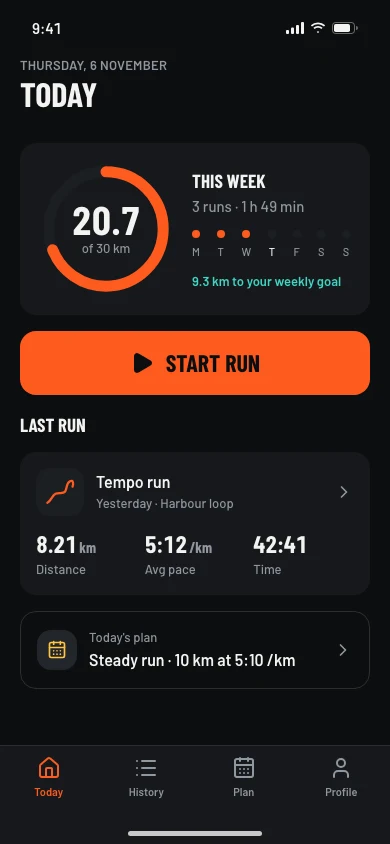
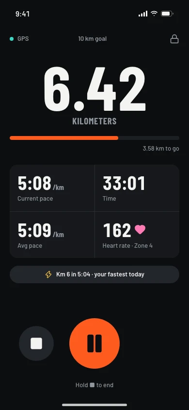
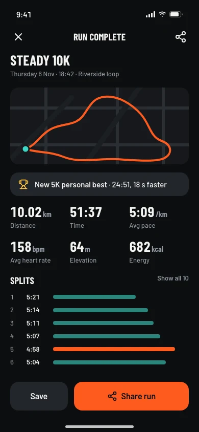
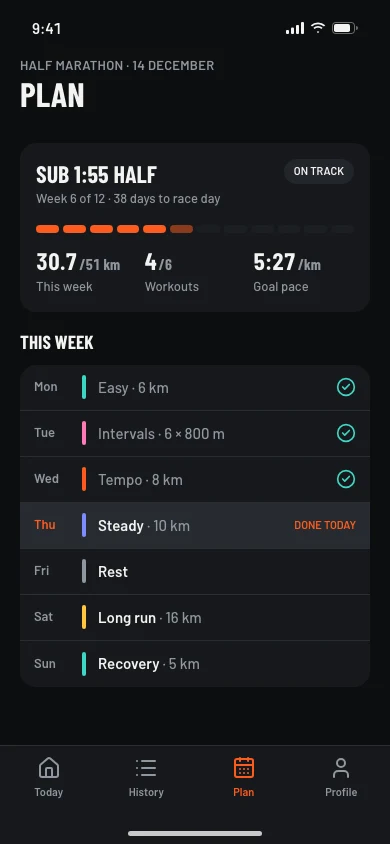

# Running app UI template

A free, complete UI design for a running and fitness tracking app: eight phone screens with realistic data, built on the [Stride design system](https://codexdesign.io/design-systems/stride). Clone it and ask Codex or Claude Code to turn it into your app.

   

## Screens

| # | Screen | What's on it |
| --- | --- | --- |
| 1 | [Today](screens/01-today.html) | Weekly distance ring, start button, last run, today's planned workout |
| 2 | [Start run](screens/02-start-run.html) | GPS status, goal type (free run, distance, time, pace), audio cues |
| 3 | [Running](screens/03-running.html) | Live distance, pace, time and heart rate, pause and stop in thumb reach |
| 4 | [Run summary](screens/04-summary.html) | Route, personal best, key stats, kilometer splits, share |
| 5 | [History](screens/05-history.html) | Weekly distance chart, list of recent runs |
| 6 | [Run detail](screens/06-run-detail.html) | Pace chart, heart rate zones, weather and shoes |
| 7 | [Plan](screens/07-plan.html) | Half marathon plan progress, this week's workouts |
| 8 | [Profile](screens/08-profile.html) | Totals, personal bests, achievements, settings |

Each screen is one HTML file at 390×844, styled with Tailwind CSS v4 (loaded from a CDN) and the shared `tokens.css`. Open any file in a browser; there is nothing to install or build. Screens are dark by default: remove `class="dark"` from `<html>` for the light theme.

## Use it

Copy just this template:

```bash
npx degit ummydev/ui-templates/apps/running my-running-app
```

Then ask your agent to make it yours:

```text
This folder is a running app UI template. Turn it into [your app name], a [what your app does]. Keep DESIGN.md and tokens.css as the design system, replace the sample data with [your data], and rename the tabs to fit the app. Then build these screens in [Expo / SwiftUI / your stack].
```

## Files

```text
DESIGN.md      the Stride design system: colors, type, spacing, app rules
tokens.css     the same tokens as CSS variables, light and dark
screens/       eight HTML screens
screenshots/   WebP screenshots at 1x and 2x
```

## Design system

Stride puts the key number first: big condensed figures with tabular digits, one energetic orange for actions and progress, 16px corners, 48px touch targets and a bottom tab bar. See it live, with a shadcn theme and the full DESIGN.md, at [codexdesign.io/design-systems/stride](https://codexdesign.io/design-systems/stride).

## License

MIT. Use it in personal and commercial projects.
