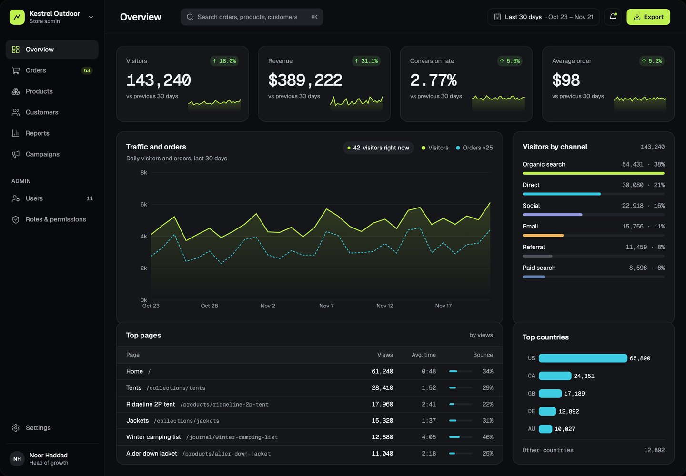
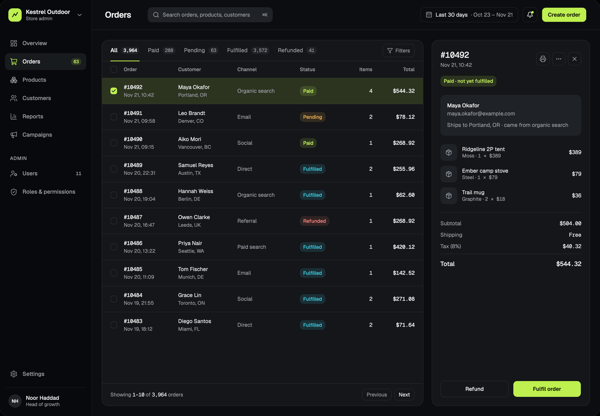
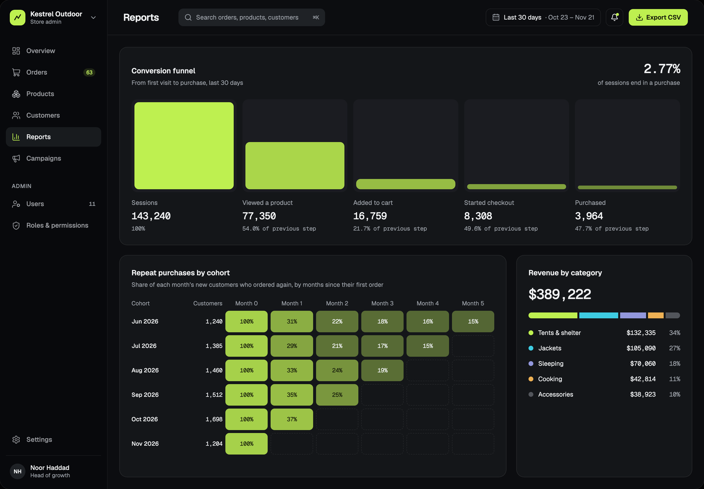
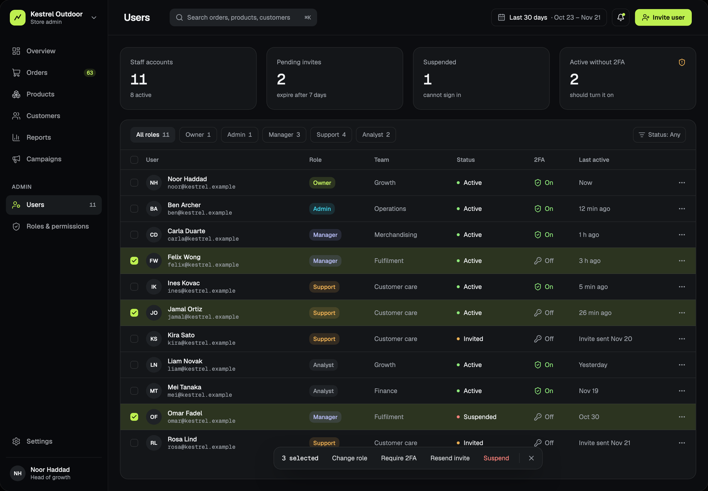
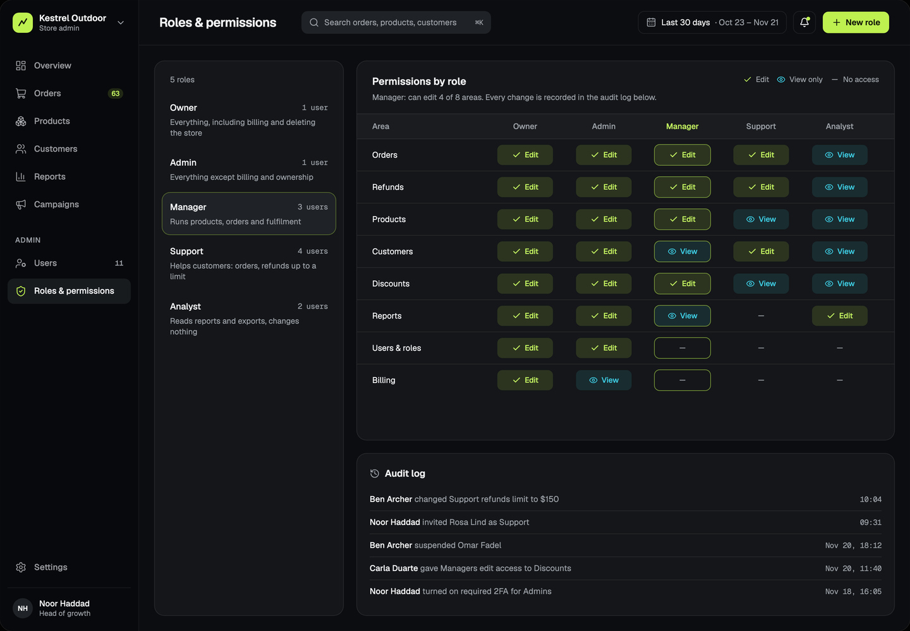

# Vantage: admin dashboard template (shadcn/ui + Tailwind)

Live preview and details: [codexdesign.io/templates/admin-dashboard](https://codexdesign.io/templates/admin-dashboard)

A dark admin dashboard (admin panel) for an online store, with five screens: an analytics dashboard (KPIs, traffic chart, channels, top pages, countries), orders with an order detail panel, reports with a conversion funnel, a cohort heatmap and revenue by category, user management with bulk actions, and roles and permissions with an audit log. Built with React, shadcn/ui, Tailwind CSS v4, Recharts and Lucide icons. The design system is in [DESIGN.md](DESIGN.md) and the theme tokens in `src/index.css`.











```bash
npx degit ummydev/ui-templates/shadcn/admin-dashboard my-admin
cd my-admin && npm install && npm run dev
```

| Screen | URL |
| --- | --- |
| Overview | `/` or `/?screen=overview` |
| Orders | `/?screen=orders` |
| Reports | `/?screen=reports` |
| Users | `/?screen=users` |
| Roles & permissions | `/?screen=roles` |

Each screen is 1440×1000. All sample data is in `src/data.ts`; see DESIGN.md for which numbers are computed.

Ask your agent to make it yours:

```text
This is the Vantage admin and analytics dashboard template. Rename it to [your product], replace the sample data in src/data.ts with [your metrics API], and keep the design system in DESIGN.md.
```

All names, stores, people and numbers are made up for the template.
