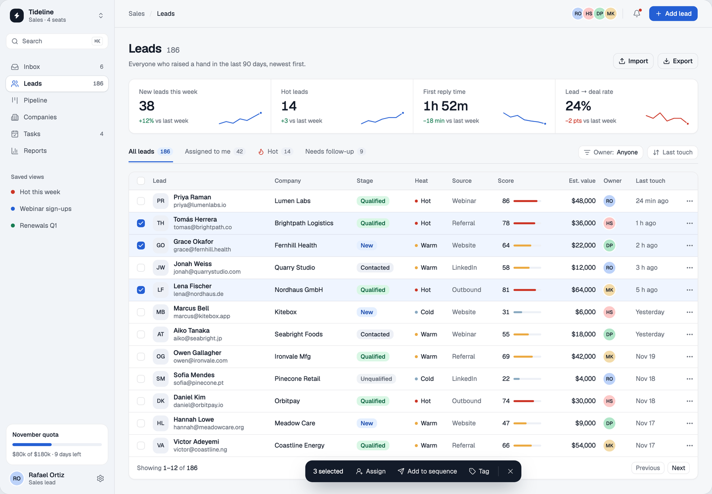
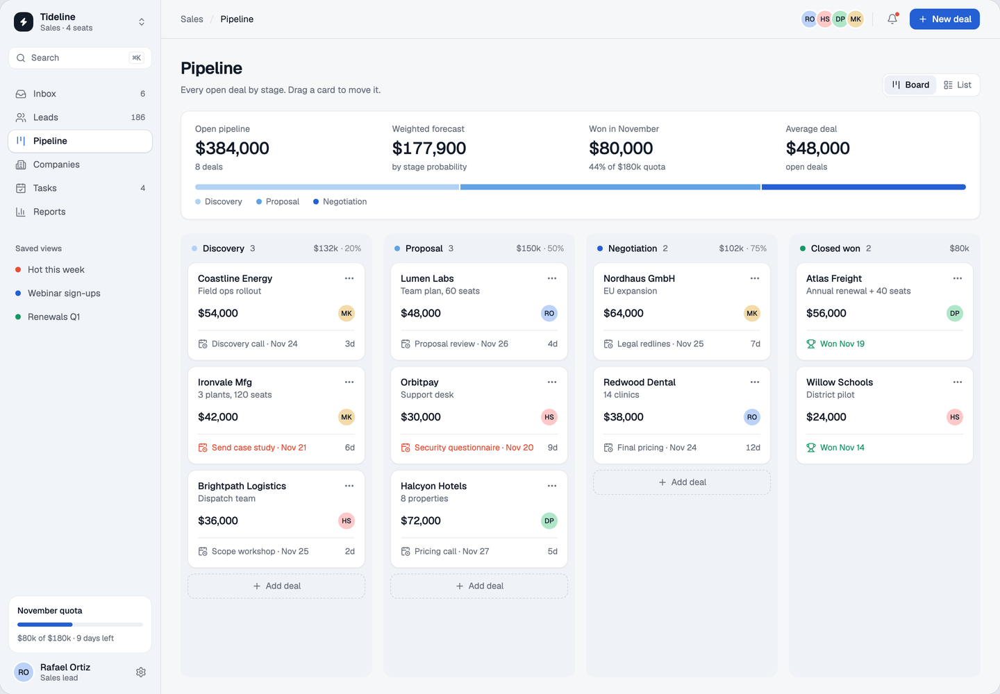
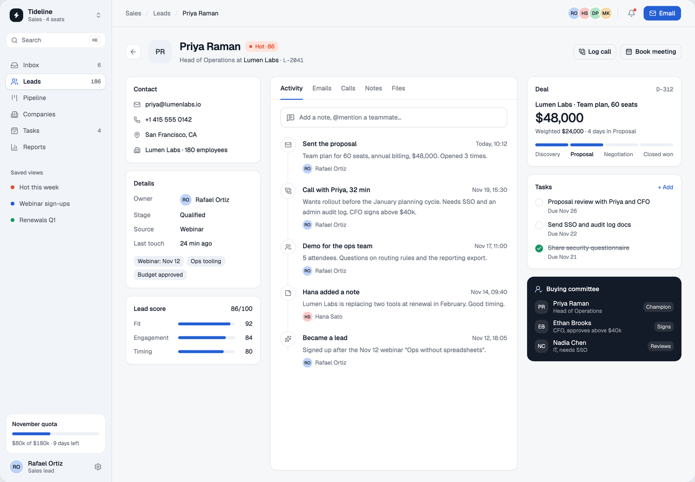

# Tideline: CRM dashboard template (shadcn/ui + Tailwind)

Live preview and details: [codexdesign.io/templates/crm-dashboard](https://codexdesign.io/templates/crm-dashboard)

A sales CRM admin dashboard with three screens: a leads table with KPIs, tabs, filters and bulk actions; a pipeline board with stage totals and a weighted forecast; and a lead record page with an activity timeline, deal progress, tasks and the buying committee. Built with React, shadcn/ui, Tailwind CSS v4 and Lucide icons. The design system is in [DESIGN.md](DESIGN.md) and the theme tokens in `src/index.css`.







```bash
npx degit ummydev/ui-templates/shadcn/crm-dashboard my-crm
cd my-crm && npm install && npm run dev
```

| Screen | URL |
| --- | --- |
| Leads | `/` or `/?screen=leads` |
| Pipeline | `/?screen=pipeline` |
| Lead record | `/?screen=lead` |

Each screen is 1440×1000. All sample data is in `src/data.ts`; totals on screen are computed from it.

Ask your agent to make it yours:

```text
This is the Tideline CRM dashboard template. Rename it to [your product], replace the sample data in src/data.ts with [your records], and keep the design system in DESIGN.md.
```

All names, companies, people, amounts and copy are made up for the template.
