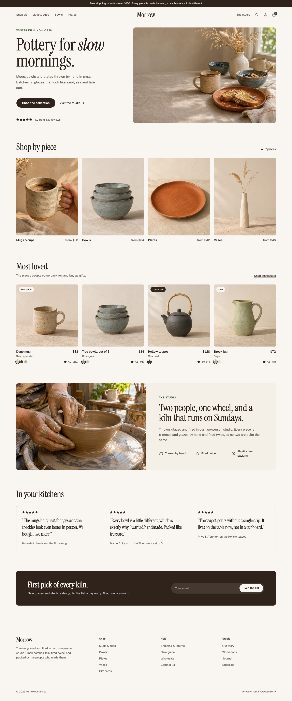
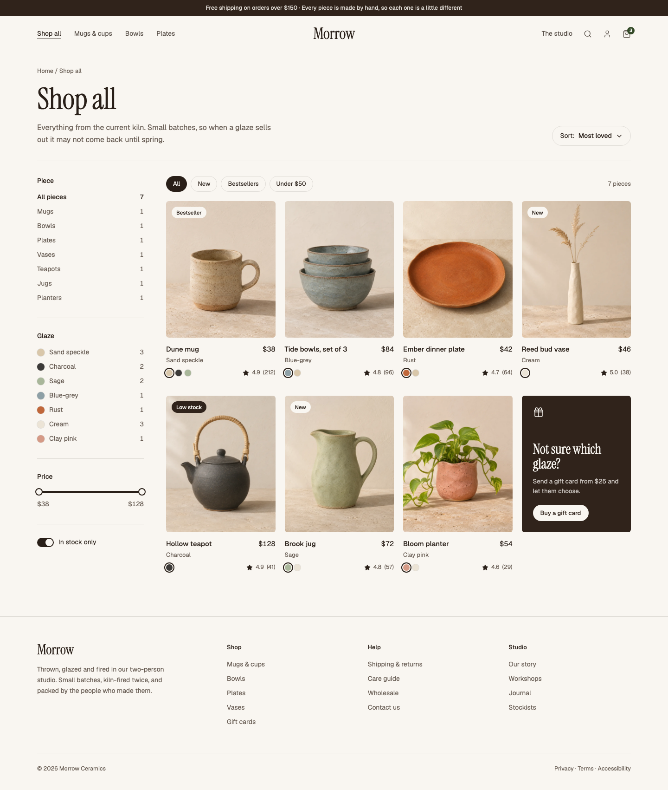
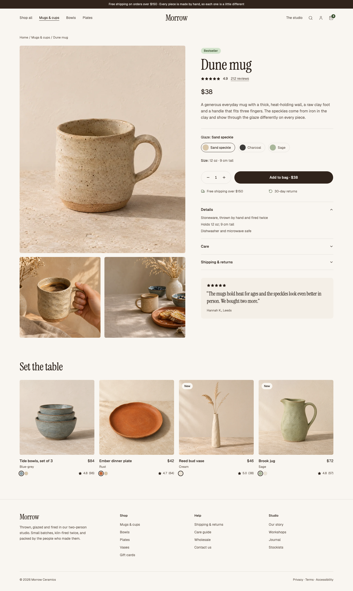
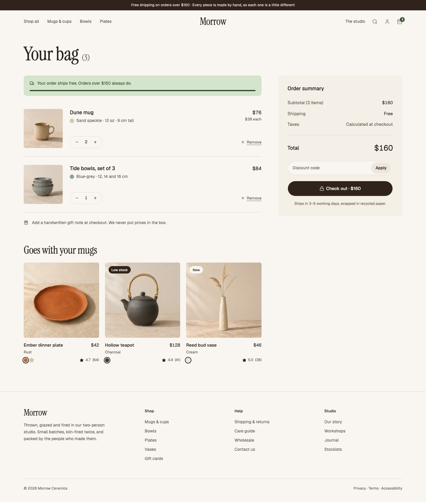

# Morrow: e-commerce website template (shadcn/ui + Tailwind)

Live preview and details: [codexdesign.io/templates/ecommerce-website](https://codexdesign.io/templates/ecommerce-website)

A storefront for a small handmade ceramics shop, with four pages: a home page, a shop page with filters, a product page and the cart. Built with React, shadcn/ui, Tailwind CSS v4 and Lucide icons. The design system is in [DESIGN.md](DESIGN.md) and the theme tokens in `src/index.css`.









```bash
npx degit ummydev/ui-templates/shadcn/ecommerce my-shop
cd my-shop && npm install && npm run dev
```

| Page | URL |
| --- | --- |
| Home | `/` or `/?page=home` |
| Shop | `/?page=shop` |
| Product | `/?page=product` |
| Cart | `/?page=cart` |

Pages are 1440px wide. All products, prices and the cart are in `src/data.ts`; counts and totals on every page are computed from it.

Ask your agent to make it yours:

```text
This is the Morrow e-commerce website template. Rename it to [your shop], replace the products in src/data.ts and the photos in public/images with [your products], and keep the design system in DESIGN.md.
```

All names, products, reviews and prices are made up for the template. The product photos were generated for it and are free to use with the template.
