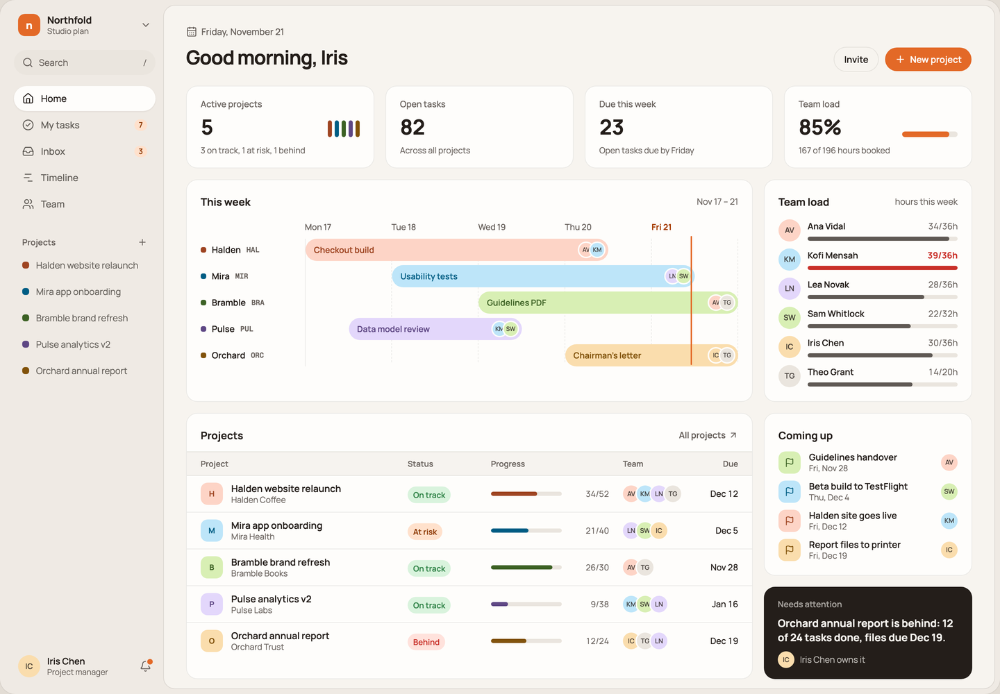
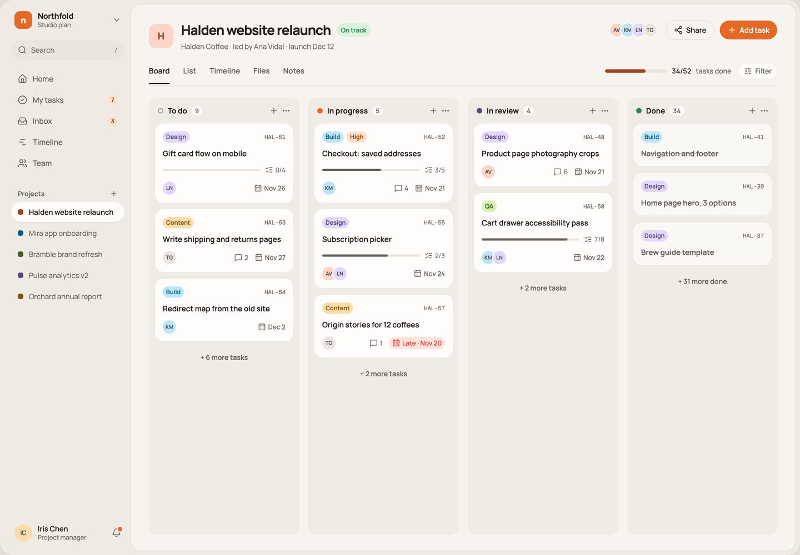
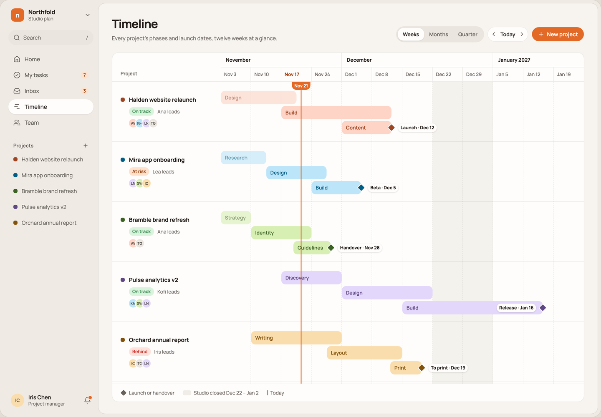

# Kiln: project management dashboard template (shadcn/ui + Tailwind)

A project management dashboard for a small studio, with three screens: an overview with KPIs, this week's schedule, team workload, projects and deadlines; a kanban task board; and a twelve-week timeline (Gantt chart) with phases and milestones. Built with React, shadcn/ui, Tailwind CSS v4 and Lucide icons. The design system is in [DESIGN.md](DESIGN.md) and the theme tokens in `src/index.css`.







```bash
npx degit ummydev/ui-templates/shadcn/project-dashboard my-projects
cd my-projects && npm install && npm run dev
```

| Screen | URL |
| --- | --- |
| Overview | `/` or `/?screen=overview` |
| Task board | `/?screen=board` |
| Timeline | `/?screen=timeline` |

Each screen is 1440×1000. All sample data is in `src/data.ts`; totals on screen are computed from it.

Ask your agent to make it yours:

```text
This is the Kiln project management dashboard template. Rename it to [your product], replace the sample data in src/data.ts with [your projects and team], and keep the design system in DESIGN.md.
```

All names, clients, people and dates are made up for the template.
