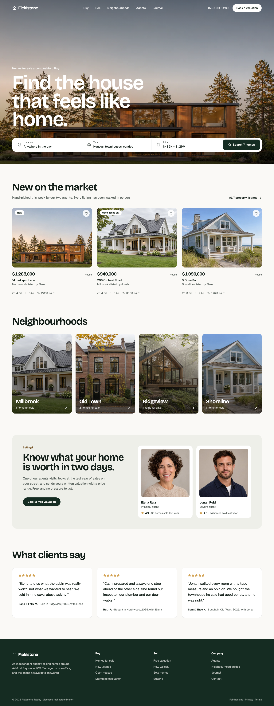
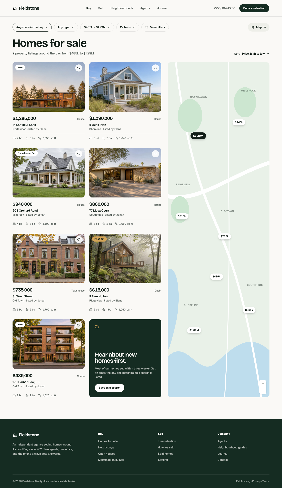
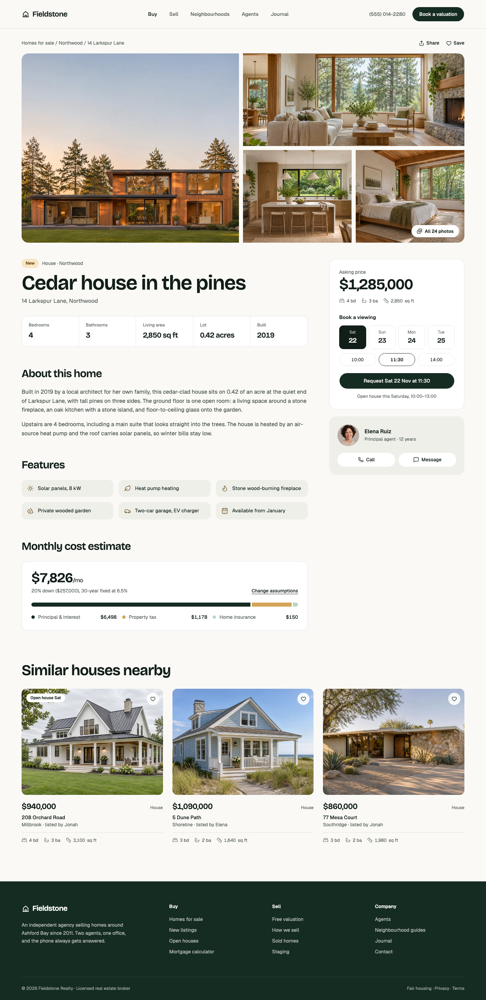
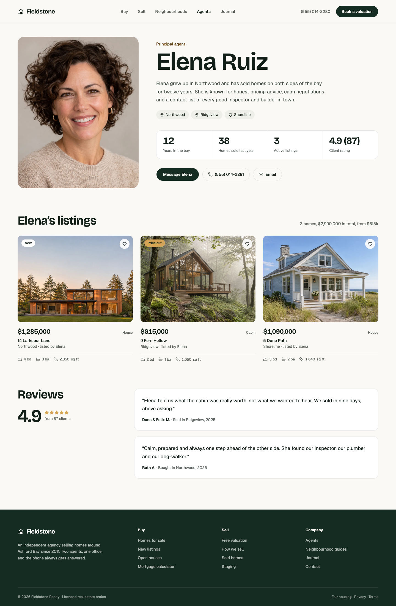

# Fieldstone: real estate website template (shadcn/ui + Tailwind)

Live preview and details: [codexdesign.io/templates/real-estate-website](https://codexdesign.io/templates/real-estate-website)

A website for a local real estate agency, with four pages: a home page with property search, property listings with a map, a property detail page and an agent profile. Built with React, shadcn/ui, Tailwind CSS v4 and Lucide icons. The design system is in [DESIGN.md](DESIGN.md) and the theme tokens in `src/index.css`.









```bash
npx degit ummydev/ui-templates/shadcn/real-estate my-agency
cd my-agency && npm install && npm run dev
```

| Page | URL |
| --- | --- |
| Home | `/` or `/?page=home` |
| Property listings | `/?page=listings` |
| Property detail | `/?page=property` |
| Agent profile | `/?page=agent` |

Pages are 1440px wide. All listings, agents and reviews are in `src/data.ts`; counts, price ranges and the monthly cost estimate are computed from it.

Ask your agent to make it yours:

```text
This is the Fieldstone real estate website template. Rename it to [your agency], replace the listings and agents in src/data.ts and the photos in public/images with [your own], and keep the design system in DESIGN.md.
```

All names, addresses, people, prices and reviews are made up for the template. The photos were generated for it and show fictional homes and people.
