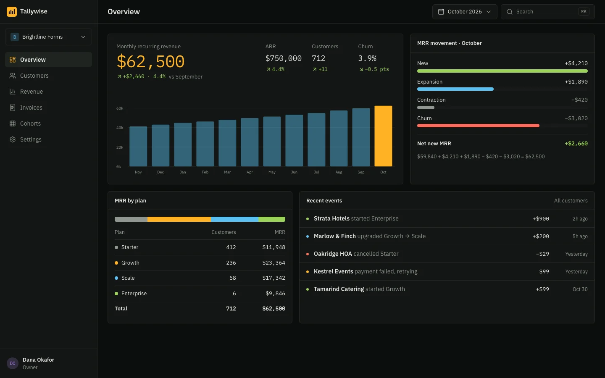
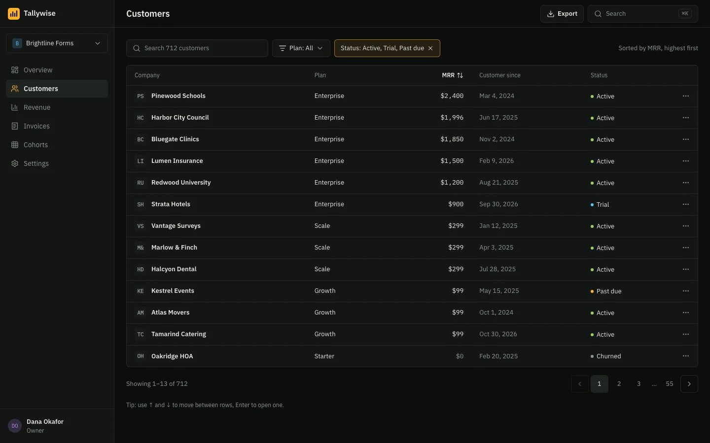
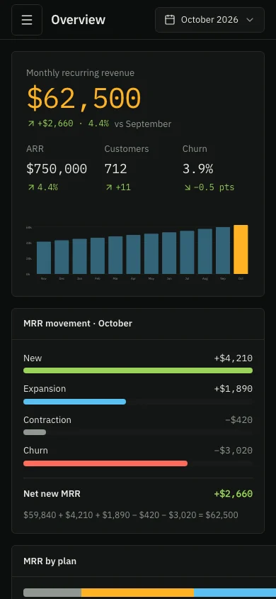

# SaaS dashboard template

A free, complete web app UI for a SaaS analytics dashboard: eight screens for a sample subscription revenue tool called Tallywise, from the MRR overview and customer list to revenue reports, invoices, cohort retention, team settings and first-run onboarding. The numbers add up on every screen. Built on the [Ledger design system](https://codexdesign.io/design-systems/ledger). Clone it and ask Codex or Claude Code to turn it into your app.



 

## Screens

| # | Screen | What's on it |
| --- | --- | --- |
| 1 | [Overview](screens/01-overview.html) | MRR, ARR, customers and churn against last month, the month's MRR movement, MRR by plan, recent events |
| 2 | [Customers](screens/02-customers.html) | Search, plan and status filters, sorting, and a table of companies with plan, MRR, start date and status |
| 3 | [Customer detail](screens/03-customer.html) | Company details, the subscription, MRR history, lifetime revenue, notes and activity |
| 4 | [Revenue](screens/04-revenue.html) | Twelve months of new, expansion, contraction and churn MRR, with a date range and CSV export |
| 5 | [Invoices](screens/05-invoices.html) | Invoices by status (open, overdue, draft, paid) next to a preview of one invoice |
| 6 | [Cohorts](screens/06-cohorts.html) | A retention table by signup month, with the weighted average and what it means |
| 7 | [Settings](screens/07-settings.html) | Team members and roles, invites, masked API keys and role permissions |
| 8 | [Onboarding](screens/08-onboarding.html) | The empty state of a new account, with steps to connect Stripe, import history and invite the team |

The sample data is a made-up company's October 2026: $62,500 MRR, $750,000 ARR, 712 customers and 3.9% churn. The four plans add up to exactly those totals, the month's movement adds up too ($59,840 + $4,210 + $1,890 − $420 − $3,020 = $62,500), and the twelve months in the revenue report end at the same MRR as the chart on the overview. Customer names are fictional.

Each screen is one HTML file, designed at 1440×900 and usable at 390 wide: the sidebar folds into a menu and tables scroll sideways. Styled with Tailwind CSS v4 (loaded from a CDN) and the shared `tokens.css`. Numbers use IBM Plex Mono with tabular figures, charts are SVG, table rows can be selected with the keyboard, and icons are Lucide. Dark is the default; remove `class="dark"` from `<html>` for the light theme. Open any file in a browser; there is nothing to install or build.

## Use it

Copy just this template:

```bash
npx degit ummydev/ui-templates/webapps/saas-dashboard my-dashboard
```

Then ask your agent to make it yours:

```text
This folder is a SaaS dashboard UI template. Turn it into [your product], for [who it's for]. Keep DESIGN.md and tokens.css as the design system, replace the metrics, plans, customers and charts with [your data], and keep every total consistent across screens. Then build it in [Next.js / React / your stack] and connect it to [your data source].
```

## Files

```text
DESIGN.md      the Ledger design system: colors, type, spacing, layout rules
tokens.css     the same tokens as CSS variables, dark and light
screens/       eight HTML screens
screenshots/   WebP screenshots at desktop and phone width, 1x and 2x
```

## Design system

Ledger is a dense, dark design system for data-heavy tools: IBM Plex Sans with IBM Plex Mono for numbers, 6px corners, and one terminal-amber accent for the active state and key values. See it live, with a shadcn theme and the full DESIGN.md, at [codexdesign.io/design-systems/ledger](https://codexdesign.io/design-systems/ledger).

## License

MIT. Use it in personal and commercial projects.
